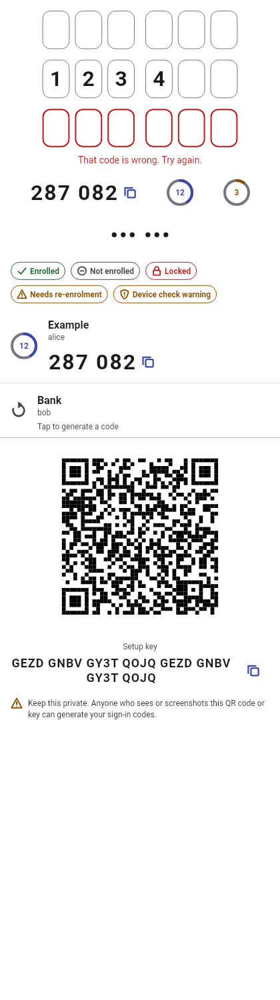

# flutter_mfa

[](https://github.com/Breaktroughf1/flutter_mfa/actions/workflows/ci.yml)
[](LICENSE)

Multi-factor authentication for Flutter — TOTP/HOTP (RFC 6238/4226), hardware-backed secure storage, QR enrolment and accessible UI widgets for **Android, iOS and Web**, plus a pure-Dart verifier for your server.

Built and maintained by **BreaktroughF1 LLP** in collaboration with **ARDC, CHRIST (Deemed to be University)**. MIT licensed.

> Status: **v0.2.0**, the first public release. Until 1.0, a minor version may change the API; each package's CHANGELOG says what changed.

| Package | What it is | pub.dev |
|---|---|---|
| [`flutter_mfa_core`](packages/flutter_mfa_core) | Pure Dart: OTP generation, verification with replay protection and throttling, otpauth URIs, Base32, encrypted backup format. Works on servers. | [](https://pub.dev/packages/flutter_mfa_core) |
| [`flutter_mfa`](packages/flutter_mfa) | The Flutter plugin: `MfaClient`, secure vault (Keystore / Keychain / WebCrypto), biometric-bound protection, sensitive clipboard. | [](https://pub.dev/packages/flutter_mfa) |
| [`flutter_mfa_ui`](packages/flutter_mfa_ui) | Widgets: code field, code display with countdown, account list, enrolment QR, status badges. Design-system independent, a11y + i18n. | [](https://pub.dev/packages/flutter_mfa_ui) |
| [`flutter_mfa_qr`](packages/flutter_mfa_qr) | Optional camera scanner for `otpauth://` QR codes. | [](https://pub.dev/packages/flutter_mfa_qr) |
| [`flutter_mfa_platform_interface`](packages/flutter_mfa_platform_interface) | Platform interface for vault implementations. | [](https://pub.dev/packages/flutter_mfa_platform_interface) |



## Install

```sh
flutter pub add flutter_mfa flutter_mfa_ui   # app: vault, codes, widgets
flutter pub add flutter_mfa_qr              # optional QR scanner
dart pub add flutter_mfa_core               # Dart server: verification
```

API reference: [pub.dev/documentation/flutter_mfa](https://pub.dev/documentation/flutter_mfa/latest/) (and the same path for each package).

## Guides
- [Add an authenticator to your app](docs/cookbook/add-an-authenticator.md): scan or type enrolments, keep secrets in the platform vault, show live codes.
- [Enrol users in two-factor sign-in](docs/cookbook/enrol-users.md): show the enrolment QR code and confirm the first code.
- [Verify codes on a Dart server](docs/cookbook/verify-on-a-dart-server.md): replay protection, shared attempt limits, storage checklist.

The [example app](packages/flutter_mfa/example) shows all of it on Android, iOS and the web.

## Platform support
| Android | iOS | Web | Dart server |
|---|---|---|---|
| API 24+ (Keystore, StrongBox) | iOS 15+ (Keychain, Secure Enclave envelope) | Secure contexts (HTTPS/localhost), JS and WASM | `flutter_mfa_core` only |

Minimum toolchain: Dart 3.9 / Flutter 3.35.

## Security model in one paragraph
Codes are **generated** on the user's device and **verified** by your server. `flutter_mfa_core` gives you the server verifier (replay protection + attempt limiting) so the same audited code runs on both sides. Seeds are stored encrypted under non-exportable platform keys, excluded from backups, and can be bound to biometrics so no code can be produced without a fresh biometric event. **On the web, storage uses a non-extractable WebCrypto key, but a script running in your origin (XSS) can still use it to produce codes: treat web as best-effort and use a strict CSP.** Details: [docs/04_SECURITY_DESIGN.md](docs/04_SECURITY_DESIGN.md).

## Privacy
The packages make no network requests, collect no telemetry and store everything locally on the device.

## Project docs
Requirements, architecture, API contract, threat model, test plan and build plan live in [docs/](docs/README.md). Design decisions: [docs/adr/](docs/adr/).

## Contributing
See [CONTRIBUTING.md](CONTRIBUTING.md) and the [Code of Conduct](CODE_OF_CONDUCT.md). Report vulnerabilities privately — see [SECURITY.md](SECURITY.md).

## Credits
See [AUTHORS.md](AUTHORS.md).
