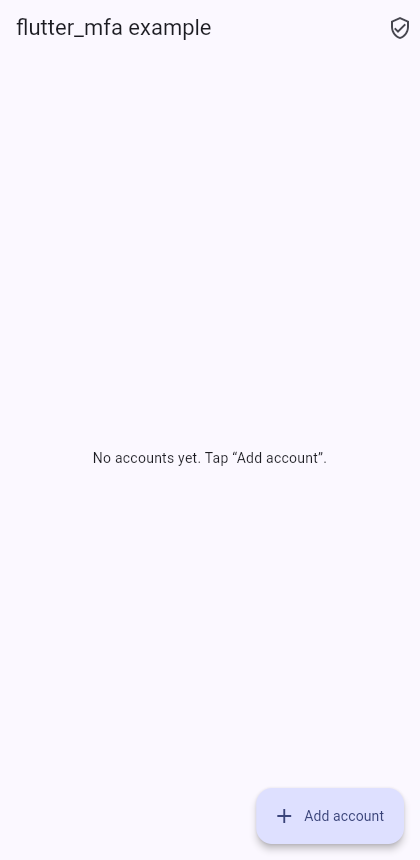
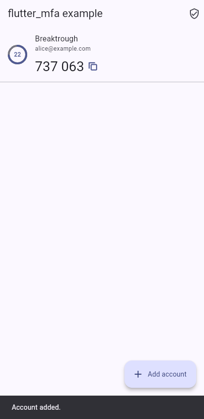
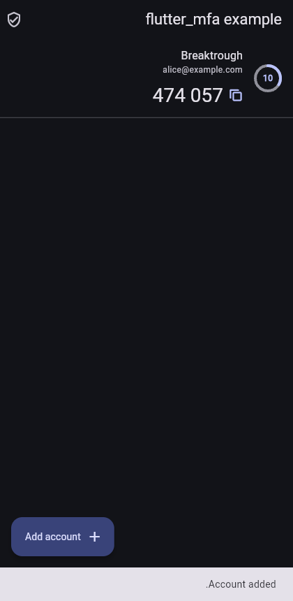
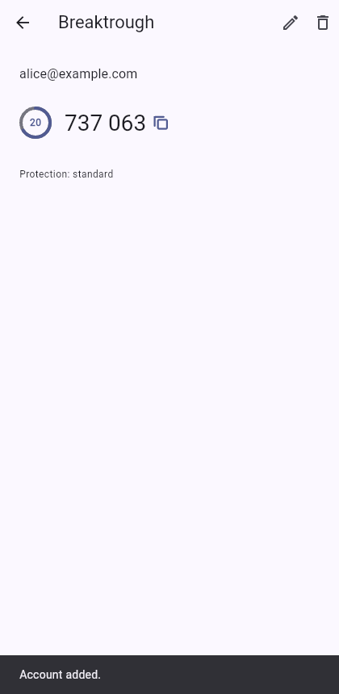

# Accessibility report — pass #1 (M2-12)

Scope: `flutter_mfa_ui` (all widgets), the `flutter_mfa_qr` status view, and the example app built on them. Requirement: FR-UI-08 (AC1 automated guideline tests, AC2 manual TalkBack + VoiceOver pass). Target: WCAG 2.1 AA.

**Status (1 Nov 2026):** the automated checks and the browser audit are done, and the defects they found are fixed. **The TalkBack and VoiceOver passes (AC2) still need real devices**, so the checklist below is for the maintainer or the ARDC testing track.

## 1. Automated checks (run in CI on every PR)

| Check | Where | Result |
|---|---|---|
| Android and iOS tap-target size (48 dp / 44 pt), labelled tap targets, text contrast (WCAG AA) over a gallery of every widget and state, light and dark | `flutter_mfa_ui/test/src/a11y/guidelines_test.dart` | Pass |
| Each labelled or interactive part is its own semantics node with its exact label, flags and actions, even inside a list item | `flutter_mfa_ui/test/src/a11y/semantics_nodes_test.dart` | Pass |
| Keyboard: every control reachable with Tab and activated with Enter or Space; focus outline only with keyboard focus; code field announced as enabled | `flutter_mfa_ui/test/src/widgets/mfa_pressable_test.dart` | Pass |
| Right to left (Arabic), Hindi, 200% text: no clipping or overflow | golden gallery, `test/goldens/` (pinned CI image) | Pass |
| Codes read digit by digit ("Code 2 8 7 0 8 2"), countdown read as "12 seconds left", errors and "Code copied" announced as live regions | widget tests per component | Pass |
| QR scanner status view: tap targets, labels, contrast | `flutter_mfa_qr/test/src/otp_qr_scanner_test.dart` | Pass |

## 2. Browser audit of the example app

Method: the example app built for the web, with Flutter's semantics tree enabled, in Chromium via Playwright (`tool/web_a11y_audit.js`). The audit records the ARIA tree that assistive technology receives on each screen, walks the Tab order, and repeats the check in Arabic with the dark theme. This is the same tree a desktop screen reader reads; it is not a substitute for TalkBack or VoiceOver on phones.

### Defects found and fixed

| # | Found by | Defect | WCAG | Fix |
|---|---|---|---|---|
| 1 | Example widget test | Inside a list item, `EnrollmentQrView`'s QR image and copy button, and `OtpCodeField`, merged with nearby text into one node, so the copy button and the field could not be focused separately | 1.3.1, 4.1.2 | Every labelled or interactive part is a semantics container ([#22](https://github.com/Breaktroughf1/flutter_mfa/pull/22)) |
| 2 | Browser audit | Account names, codes and "Copy setup key" were not reachable with Tab | 2.1.1 | `MfaPressable` (focusable, Enter/Space, focus outline) at every tap site in ui and qr ([#25](https://github.com/Breaktroughf1/flutter_mfa/pull/25)) |
| 3 | Browser audit | `OtpCodeField` was announced as a **disabled** textbox and skipped by Tab | 4.1.2, 2.1.1 | The field declares that it is enabled ([#25](https://github.com/Breaktroughf1/flutter_mfa/pull/25)) |
| 4 | Browser audit | No visible keyboard focus indicator on custom controls | 2.4.7 | `MfaPressable` draws a 2 px outline in the theme's primary colour while it has keyboard focus ([#25](https://github.com/Breaktroughf1/flutter_mfa/pull/25)) |

### Result after the fixes

The ARIA tree of the account list, with labels exactly as a screen reader receives them:

```
- heading "flutter_mfa example" [level=2]
- button "Relying-party demo"
- group:
  - text: 22 seconds left
  - button "Code 7 3 7 0 6 3"
  - button "Breaktrough, alice@example.com"
- button "Add account"
```

Tab order on the list: Relying-party demo → account (Breaktrough, alice@example.com) → its code → Add account. On the relying-party demo: Back → Service name → User account → Generate → **Copy setup key** → Or add it to this app → **One-time code** (enabled textbox). The account detail page exposes Back, the heading, Rename, Remove, the countdown and the code as a button.

Arabic, dark theme: the widgets' labels are localized (`الرمز 1 8 6 7 3 3`, `تبقّت ثانيتان`) and the Arabic comma separates issuer and account.

| | |
|---|---|
|  |  |
|  |  |

### Open items for the manual pass

1. **Reading order inside an account row.** Tab order is name then code, but the ARIA tree lists the code before the name, so a screen reader's swipe order may read the code first. Check on TalkBack and VoiceOver; if the code is read first, give the row an explicit order (`OrdinalSortKey`).
2. **Setup-key group label.** On the web the group around the QR code carries the setup key and the privacy warning as one label. Check that VoiceOver and TalkBack read the key in groups and the warning separately.
3. **Example app strings** (titles, buttons, snackbars) are English only. Only the toolkit's widgets are localized. This is expected for an example, but don't mistake it for a widget defect.

## 3. Manual pass (FR-UI-08 AC2), for real devices

Run on the example app (`packages/flutter_mfa/example`) with an account added through "Enter setup key", using the RFC test secret `GEZDGNBVGY3TQOJQGEZDGNBVGY3TQOJQ`. Record the device, OS version and result for each row.

| # | Step | Pass when | Android TalkBack | iOS VoiceOver |
|---|---|---|---|---|
| 1 | Swipe through the account list | Each row announces the account ("Example, alice"), the time left and the code digit by digit; nothing is read twice | ☐ | ☐ |
| 2 | Double-tap the code | It is copied and "Code copied" is announced | ☐ | ☐ |
| 3 | Open the account and wait for the code to change | The new code is not announced every second (no live-region spam); the countdown is readable | ☐ | ☐ |
| 4 | Add an account with "Enter setup key" | Every field has a label, errors are announced | ☐ | ☐ |
| 5 | Relying-party demo: focus the QR code, the setup key and "Copy setup key" separately | The QR announces "QR code to add this account to an authenticator app"; the key is readable; the privacy warning is read | ☐ | ☐ |
| 6 | Type into the one-time-code field | Announced as "One-time code, text field" with the hint "Enter the 6-digit code"; each digit is echoed; a wrong code announces the error | ☐ | ☐ |
| 7 | Paste a code (long-press the field) | The Paste action is reachable and fills every box | ☐ | ☐ |
| 8 | Scan screen with camera permission denied | The message and "Try again" / "Open settings" are announced and reachable | ☐ | ☐ |
| 9 | System font size at maximum | No clipped text on the list, detail and demo screens | ☐ | ☐ |
| 10 | Arabic system language | Widgets read in Arabic and lay out right to left; codes stay left to right | ☐ | ☐ |
| 11 | Hardware keyboard or switch access (Android) | Every control is reachable and shows a focus outline | ☐ | n/a |

Report defects as GitHub issues labelled `a11y`, linking the row number above.
